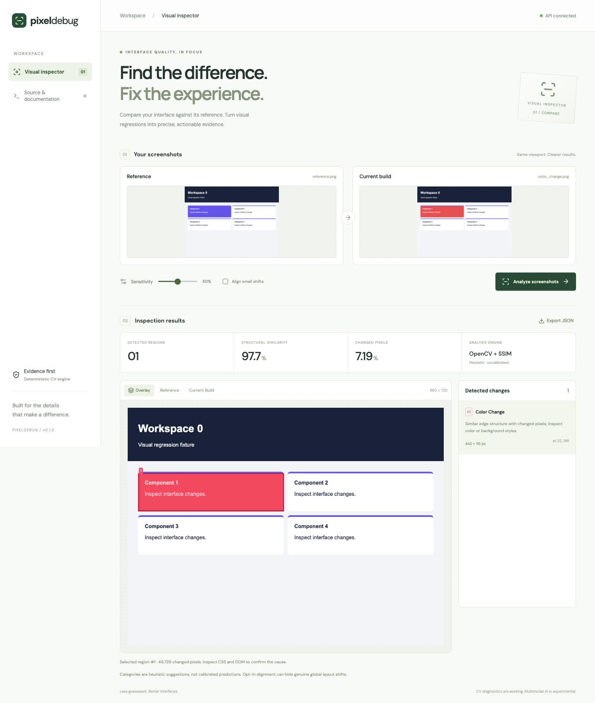
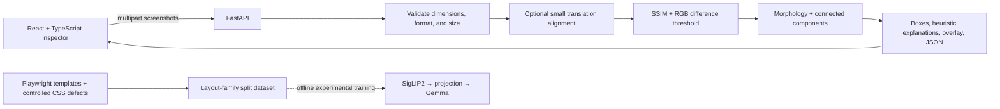

# PixelDebug

**Find visual regressions. Inspect the evidence. Export the diagnosis.**

[](https://github.com/aakankshapeeru/pixelDebug/actions/workflows/ci.yml)

PixelDebug compares a reference screenshot with a current web interface, localizes changed regions, and makes them inspectable in a React dashboard. OpenCV and structural similarity provide a working, deterministic baseline without external AI APIs. An experimental PyTorch bridge connects actual Hugging Face SigLIP2 and Gemma architectures for future task-trained diagnoses.

**Status:** screenshot comparison, API, dashboard, synthetic-data rendering, and Docker execution are verified. Tiny random-weight model training, gradients, inference, and checkpoint round trips are verified. **Pretrained multimodal diagnosis is not validated or served**: Gemma configuration access returned HTTP 401 in this environment. No mocked AI outputs are presented as diagnoses.



[Watch the recorded browser demo](docs/demo.webm) · [View the mobile layout](docs/dashboard-mobile.png)

## What you can do

- Upload PNG, JPEG, or WebP screenshots of the same viewport.
- Compare perceptual and pixel differences with configurable sensitivity.
- Inspect localized regions on overlay, reference, and current screenshots.
- Get heuristic color/layout suggestions, changed-pixel counts, and SSIM.
- Download structured JSON, including box coordinates and explanations.
- Generate reproducible browser-rendered defect pairs with ground truth.
- Run a frozen-encoder/frozen-LM projector training workflow when model access is available.

A changed region is evidence, not a confirmed CSS root cause. SSIM and changed-pixel fraction are measurements, **not calibrated confidence scores**. The UI deliberately does not display invented confidence.

## Quick start

Requires Docker Desktop / Docker Engine with Compose:

```bash
git clone https://github.com/aakankshapeeru/pixelDebug.git
cd pixelDebug
docker compose up --build -d --wait
```

Open **http://localhost:8080**. API documentation is at **http://localhost:8080/api/docs** (OpenAPI schema: `/api/openapi.json`). The backend is internal to the Compose network; the frontend proxies `/api/*` requests.

```bash
# Health and real comparison through the production proxy
curl --fail http://localhost:8080/api/health
curl --fail -X POST http://localhost:8080/api/analyze \
  -F reference=@docs/examples/reference.png \
  -F defective=@docs/examples/current.png \
  -F sensitivity=0.5 > report.json
docker compose down
```

Try the included [reference](docs/examples/reference.png) and [current screenshot](docs/examples/current.png). They are generated fixtures, not third-party content. A full [example JSON report](docs/example-report.json) is included; the downloadable report omits the large base64 overlay.

### Local development

Python 3.12 and Node 22 were used for validation. Python 3.11+ is supported by the project metadata, but other Python versions have not been tested here.

```bash
python3.12 -m venv .venv
source .venv/bin/activate
pip install -r requirements.lock
pip install -e '.[dev]'
cp .env.example .env
uvicorn pixeldebug.api:app --host 127.0.0.1 --port 8000
# In another terminal:
npm ci --prefix frontend
npm run dev --prefix frontend
```

Open **http://localhost:5173**. Vite proxies `/api` to port 8000. The browser and API must run on the same machine for these loopback URLs. No Hugging Face access is needed for the working application.

## Architecture



- `pixeldebug/vision.py`: image decoding, alpha compositing, optional phase correlation, SSIM, thresholding, localization, and PNG overlay.
- `pixeldebug/api.py` / `limits.py`: typed API, bounded multipart bodies, concurrency control, JSON request logs, and CORS configuration.
- `pixeldebug/dataset.py` / `evaluate.py`: renderer, ground truth, structural-family splits, and CV metrics.
- `pixeldebug/ml.py` / `evaluate_ml.py` / `diagnostics.py`: visual prefix, training, safe adapter checkpoints, greedy inference, strict JSON validation, and semantic/localization metrics.
- `frontend/`: responsive React UI; Vite development proxy and nginx production proxy.

### CV tradeoffs

Screenshots must share dimensions; silently resizing would introduce false evidence. Alignment is off by default because a global shift can itself be a defect. Opt-in phase correlation accepts only translations up to 8 px with correlation response above 0.5, excludes introduced border pixels, and reports the transformation. With alignment enabled, boxes are in the reference/aligned coordinate frame.

SSIM catches structural changes while a pixel threshold suppresses small antialiasing noise. Morphological closing groups nearby changes; connected components produce boxes. Similar edges suggest a color change; other regions receive a broad layout/content suggestion. This does not reliably distinguish missing elements, typography, spacing, and overflow semantically. Those six labels exist in dataset ground truth and the experimental model schema.

## API

| Endpoint | Behavior |
| --- | --- |
| `GET /health` | Service liveness and version |
| `POST /analyze` | Multipart `reference`, `defective`, `sensitivity` (0–1), optional `align` |
| `POST /predict` | HTTP 503 with an explicit training/validation requirement |
| `GET /model/info` | CV readiness and truthful experimental model status |

`/analyze` returns `width`, `height`, `ssim`, `changed_fraction`, `alignment`, `defects`, `overlay` (PNG data URI), `diagnosis_source`, and `warnings`. Each defect has an ID, `{x,y,width,height}` box in pixels, category, explanation, evidence source, and changed-pixel count. Invalid images, mismatched dimensions, and invalid settings return 422; oversized requests return 413. Full typed schemas are available in `/docs` when accessing FastAPI directly.

Environment settings use the `PIXELDEBUG_` prefix. Defaults: `MAX_UPLOAD_BYTES=8388608` per file, `MAX_PIXELS=12000000`, `MAX_CONCURRENT_ANALYSES=2`, `ALLOWED_ORIGINS=["http://localhost:5173"]`. Total body size is bounded to twice the per-file limit plus 64 KiB before multipart parsing, including chunked requests. Request logs omit uploaded content and credentials.

The included Compose setup binds only to loopback. Before exposing it publicly, add authentication, TLS, request timeouts/rate limits, and workload-appropriate memory limits. SSIM produces sizeable intermediate arrays; lower the pixel limit or concurrency on constrained machines. No persistence or upload retention is implemented.

## Dataset generation and evaluation

```bash
source .venv/bin/activate
python -m playwright install chromium
python -m pixeldebug.dataset --output data/synthetic --families 20
python -m pixeldebug.evaluate data/synthetic --split test
```

The historical `--families` option controls **20 visual variants**, rendered into 120 defective/reference pairs (six defects each). All variants of a structural family—2-, 3-, or 4-column layouts—stay together: train 42, validation 42, test 36. Each JSONL row records paths, split, structural family, variant, category, target-element union box, and JSON training target. No individual screenshot or sibling CSS variant crosses splits. This is a small synthetic benchmark with only three structural families, not a representative web-interface corpus.

Injected defects: color changes, hidden elements, translation, overflow, typography changes, and padding/spacing. Boxes use the union of the target DOM element before/after injection. Reflow may affect neighbors outside that annotation; shadows and browser antialiasing also limit box agreement. Templates use system Arial, a fixed 960 × 720 viewport, and device scale factor 1; browser/platform font rendering can change measured values.

Measured on the 36 held-out examples with sensitivity 0.5:

| Metric | Result |
| --- | ---: |
| Target recall at IoU ≥ 0.5 | 77.78% (28/36) |
| Mean best box IoU | 0.7343 |
| Total predicted regions | 738 |

These are **CV localization metrics**, not model accuracy. The large region count exposes fragmentation, especially on reflow and text. Recall alone does not penalize extra boxes; no precision claim is made because annotations cover only the injected target. Raw results are in [benchmark.json](docs/benchmark.json). Production usefulness still needs real-page evaluation, region merging, false-positive assessment, and accessibility/contrast checks beyond screenshots.

## Experimental SigLIP2 + Gemma model

```text
reference/current RGB screenshots
  → SigLIP2 processor (patches + attention masks + spatial shapes)
  → frozen SigLIP2 patch sequences
  → remove padding; pool each sequence to 16 tokens
  → reference, current, and signed difference sequences
  → trainable LayerNorm + Linear + GELU + Linear, plus role embeddings
  → 48-token visual prefix in Gemma's hidden dimension
  → frozen Gemma causal decoder with prompt + JSON target
```

The projector bridges vision and language dimensions. Teacher forcing applies causal language-model loss to JSON target tokens only; prefix and prompt labels are `-100`. Vision features are computed without gradients, but the frozen Gemma forward remains in the autograd graph so training gradients reach the projector. The input attention mask includes visual-prefix tokens. Only projection weights and role embeddings are updated; base weights are never saved in the repository.

Why this architecture: it reuses pretrained representations and limits trainable parameters, while paired/difference tokens preserve comparison context. Tradeoffs: frozen LMs may not learn precise coordinates through a small prefix; pooling loses fine text detail; full-resolution crop features or an object-aware encoder could help. The current decoding loop recomputes the prefix context rather than implementing a KV-cache optimization.

```bash
pip install -e '.[ml]'
# Accept the Gemma license and configure HF_TOKEN in your shell if required.
# Do not commit or paste the token into a file in the repository.
python -m pixeldebug.ml train data/synthetic --output checkpoints/bridge --epochs 1
python -m pixeldebug.ml infer checkpoints/bridge docs/examples/reference.png docs/examples/current.png
python -m pixeldebug.evaluate_ml checkpoints/bridge data/synthetic --split test
```

Training selects the best adapter by validation example-mean NLL; the test set is not used for selection. Checkpoints contain model identifiers, seed, pooling configuration, and safe-tensors adapter weights; reload rejects mismatched configurations. These are inference/best-model checkpoints, not optimizer-state resumptions. Training uses deterministic seeds, frozen base models, AdamW, and gradient clipping. Inference uses greedy decoding and rejects malformed JSON, unknown categories, invalid boxes, and out-of-bounds coordinates. Evaluation reports valid JSON rate, one-to-one IoU precision/recall, and category-correct recall, counting invalid outputs as failures.

**Verified:** real tiny random-weight SigLIP2/Gemma architectures train for 12 steps, pass nonzero projector gradients, retain frozen base weights, decrease example loss from 3.4788 to 3.4712, reproduce outputs after adapter reload, and generate deterministically. **Not verified:** pretrained base-model loading together, full dataset training/validation, diagnosis quality, model evaluation numbers, or online AI serving. Public SigLIP2 config returned 200; gated Gemma config returned 401. Tiny-model mechanics do not demonstrate learned visual diagnosis. CPU-only validation was used; no GPU training was performed.

## Verification

```bash
pip install -e '.[dev,ml]'
pytest -q
npm ci --prefix frontend
npm run build --prefix frontend
# Start the API and Vite servers, and generate the dataset first:
python scripts/wait_ready.py
python scripts/browser_smoke.py
```

Tests cover image validation, transparency, identical images, box localization, API validation and limits (including chunked uploads), CORS, family splits, strict generated JSON, real tiny-model training and checkpoint/inference, and one-to-one matching. Browser smoke checks real uploads through the proxy, box selection, JSON export, JavaScript errors, and mobile overflow. Docker images were built and Compose health plus real production-proxy analysis were exercised. CI repeats tests, rendering/evaluation, TypeScript build, browser smoke, and Docker build/start checks on Linux.

See [verification evidence](docs/VERIFICATION.md) and [interview notes / accurate resume wording](docs/INTERVIEW.md). Screenshot captures: [desktop](docs/dashboard-results.png), [empty state](docs/dashboard-empty.png), [mobile](docs/dashboard-mobile.png).

## Next improvements

- Merge text/reflow fragments; evaluate false positives on real sites and dynamic content.
- Expand structurally distinct templates and add unchanged negative pairs.
- Obtain Gemma access, train the adapter, validate JSON/semantic quality, and compare against CV-only and image-ablation baselines.
- Add crop-aware visual tokens and evaluate coordinate normalization.
- Serve a model only after held-out quality, latency, and memory measurements meet an explicit threshold.
- Add a queued worker, cancellation, and access controls for multi-user deployments.

## Stack

Python · OpenCV · scikit-image · FastAPI · Pydantic · PyTorch · Hugging Face Transformers · SigLIP2 · Gemma · Playwright · React · TypeScript · Vite · nginx · Docker Compose · pytest · GitHub Actions.

MIT licensed. Model weights retain their upstream licenses and access requirements.
